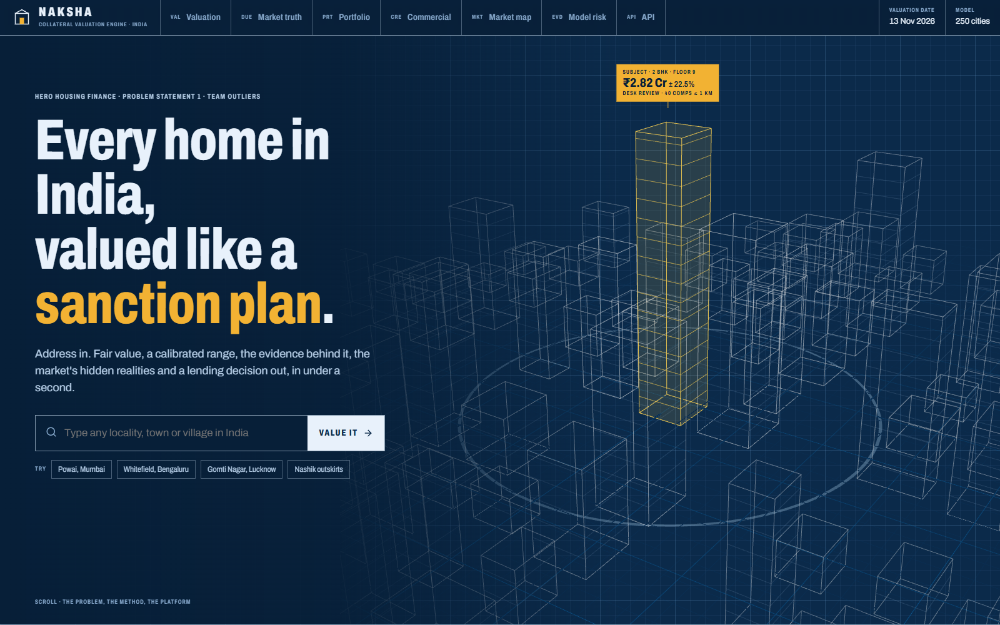
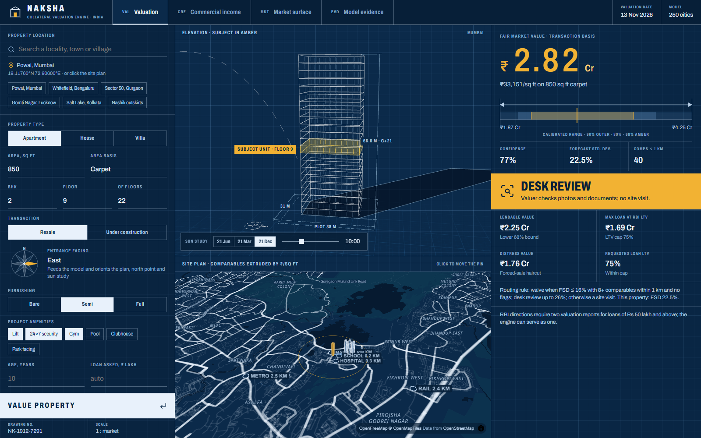
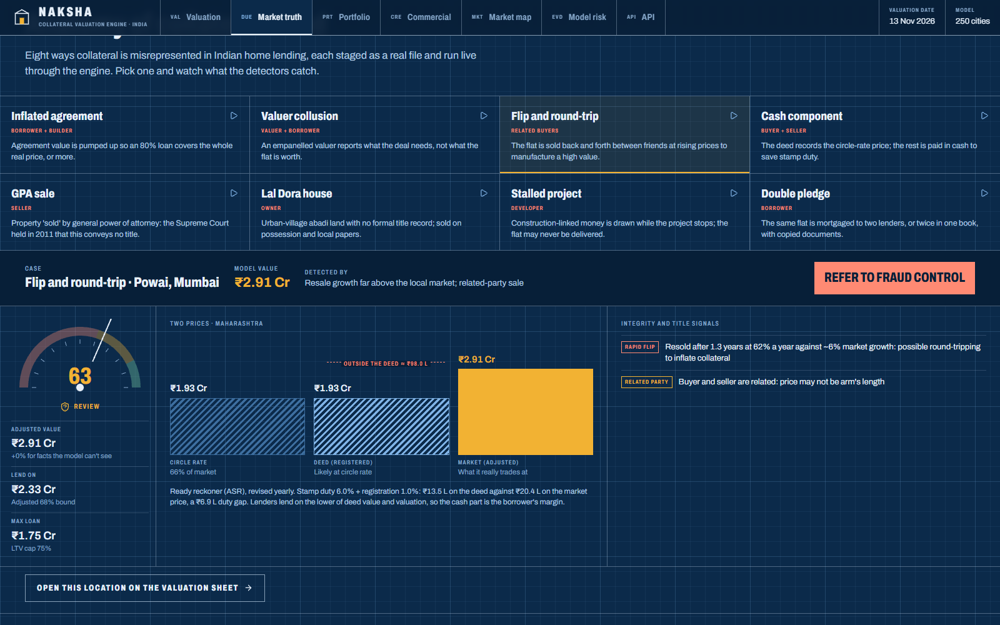
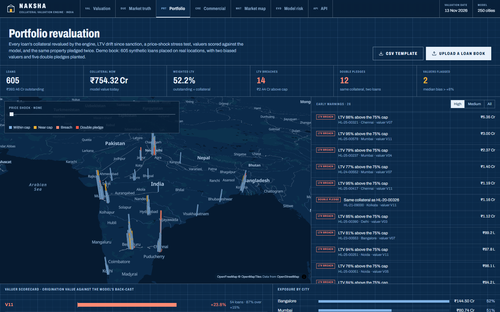
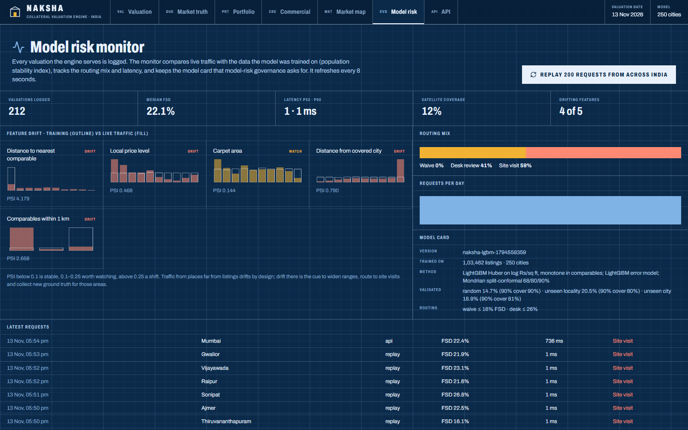
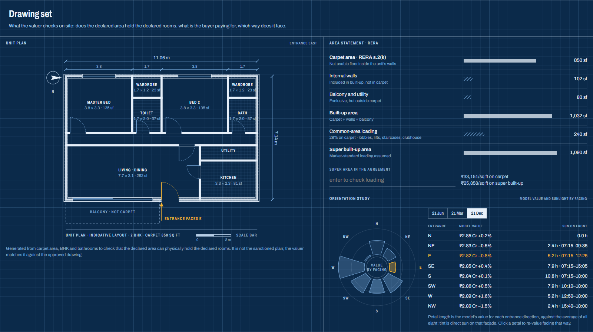
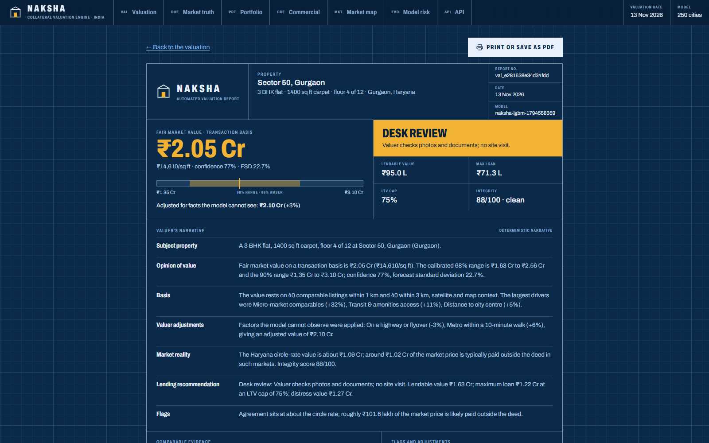
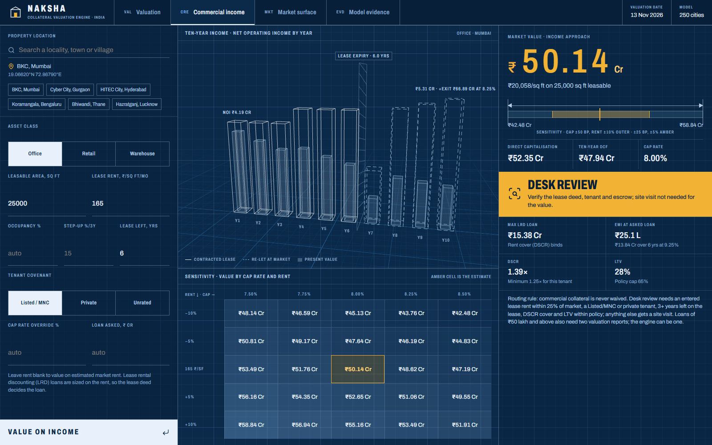
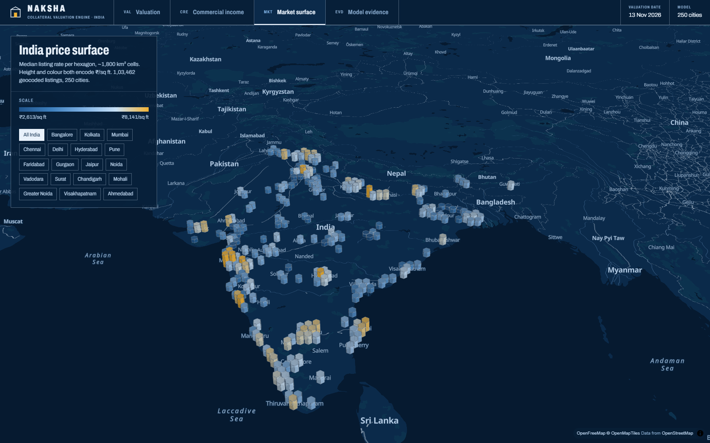
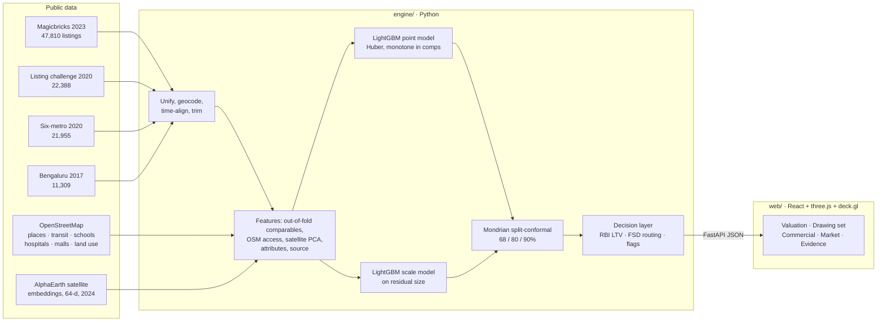

<div align="center">


# Naksha

### AI collateral valuation engine for Indian housing finance

**Address or map pin in → fair value, calibrated range, confidence, the reasons behind it, and a lending decision: waive the site visit, desk review, or physical valuation.**

*Naksha* (नक्शा) is Hindi for map, or plan: the drawing an architect submits for sanction.


Built for **Hero Housing Finance · Problem Statement 1: AI-Powered Digital Property Valuation Engine for India**

</div>

---



## Why this exists

A housing-finance lender in India pays for a physical valuation on almost every loan. The valuer is often anchored to the circle rate or a single property portal. The report states one number and gives no sense of how far to trust it.

The automated valuation models (AVMs) that exist mostly read one data source and return a bare point estimate. That doesn't help a credit officer decide whether a site visit can be skipped.

Naksha is built around that decision. Every valuation ships with three things:

1. **A value with a calibrated range.** A conformal 90% range holds the true price 90.2% of the time on held-out listings. When the data is thin, the range widens and the routing gets stricter instead of bluffing.
2. **The reasons behind it.**
   - Exact factor attribution.
   - The comparable listings it leaned on.
   - What each data source would have said.
   - A land and structure split.
   - Risk flags.
3. **A lending answer in the officer's terms.** Lendable value, maximum loan under the RBI LTV caps, distress value, and a routing decision: **waive / desk review / physical visit**.

It answers for **any point in India**. Deep coverage spans 250 cities with listings; elsewhere it still values the property, with wider ranges, flags, and physical-visit routing.

## Results

Median absolute error against held-out listings (lower is better). Every method is scored on the same rows. Full method in [docs/MODEL.md](docs/MODEL.md).

| Held-out test | **Naksha** | Attributes-only ML | Locality median *(portal-style)* | Hedonic regression | City median |
|---|:---:|:---:|:---:|:---:|:---:|
| Random holdout (15,519 listings) | **14.7%** | 16.2% | 18.3% | 24.2% | 25.2% |
| Unseen localities (13,780) | 20.5% | **19.4%** | 25.2% | 24.2% | 25.2% |
| Unseen tier-2 cities (4,262 · 8 cities) | **18.9%** | 25.7% | 33.1% | 21.8% | 33.1% |

| Range promised | Observed coverage: random | Unseen localities | Unseen cities |
|---|:---:|:---:|:---:|
| 68% | 68.1% | 55.6% | 55.3% |
| 80% | 80.5% | 67.9% | 68.0% |
| 90% | **90.2%** | 80.2% | 80.9% |

> [!NOTE]
> **Read these numbers honestly.**
> - **Ground truth is asking prices, not registered sales.** These are public listings rolled to the valuation date, with a 6% ask-to-sale discount. No public registry data exists.
> - **One loss:** on whole unseen localities, a simpler attributes-only model beats Naksha by about one point. The likely cause is locality-level geocoding of many listings.
> - **Ranges under-cover on unseen areas.** That is why unseen areas raise thin-data flags and route to a physical visit.
>
> The *Model evidence* sheet in the app shows all of this.

## What's inside

Naksha is a website with one engine behind eight pages.

| Page | Path | What a credit officer gets |
|---|---|---|
| **Landing** | `/` | <ul><li>A 3D city that builds itself around the subject property</li><li>Live search of any locality, town or village in India</li><li>The problem, the method and the benchmark in one scroll</li></ul> |
| **Valuation** | `/value` | <ul><li>Value as a measured dimension with 68/80/90% bands, confidence and the routing decision</li><li>3D elevation with sun path and cast shadow, and a 3D site plan of comparables</li><li>**Reality check:** integrity dial, the "two prices" of the home (circle rate, deed, market), valuer adjustments and fraud signals</li><li>**Drawing set:** generated unit plan, RERA area statement, orientation study, construction-stage disbursement</li><li>Factor attribution, source reconciliation, comparables</li></ul> |
| **Market truth** | `/diligence` | <ul><li>A two-prices calculator for 24 states: circle rate vs deed vs market, cash outside the deed, stamp duty lost</li><li>**Fraud scanner:** eight collateral schemes run live through the engine</li><li>A tornado chart of the factors listings never record, and the title ladder with LTV caps</li></ul> |
| **Portfolio** | `/portfolio` | <ul><li>Revalue a whole loan book on a 3D map</li><li>Price-shock stress slider, LTV drift, early warnings</li><li>Valuer scorecard and double-pledge detection</li><li>Upload your own CSV</li></ul> |
| **Commercial** | `/commercial` | <ul><li>Office, retail or warehouse by direct capitalisation plus a ten-year DCF</li><li>3D cash-flow columns, a sensitivity grid and LRD loan sizing</li></ul> |
| **Market map** | `/market` | A 3D H3 hexagon price surface of India; fly into 18 major cities. |
| **Model risk** | `/model` | <ul><li>Live drift monitor (PSI against the training data), routing mix, latency and the model card</li><li>The benchmark against four baselines on three splits, calibration plot and ablations</li></ul> |
| **API** | `/developers` | `POST /api/v1/valuations` for the loan-origination system, with a live "Try it" console |
| **Report** | `/report` | A printable sanction-style valuation report. Claude Opus 5.5 writes the narrative when credentials are present, with every number checked against the valuation; otherwise a deterministic narrative is used. |

<table>
<tr>
<td width="50%"><br/><sub><b>Valuation.</b> Elevation with sun study, site plan, value with its range, and the decision.</sub></td>
<td width="50%"><br/><sub><b>Market truth.</b> A staged flip routed to fraud control, with the integrity dial and the two prices.</sub></td>
</tr>
<tr>
<td width="50%"><br/><sub><b>Portfolio.</b> 605 loans revalued; breaches, double pledges and biased valuers surfaced.</sub></td>
<td width="50%"><br/><sub><b>Model risk.</b> Live traffic against the training data, routing mix and the model card.</sub></td>
</tr>
<tr>
<td width="50%"><br/><sub><b>Drawing set.</b> Generated unit plan, RERA area statement, value and sunlight by facing.</sub></td>
<td width="50%"><br/><sub><b>Report.</b> Sanction-style report with a number-locked narrative.</sub></td>
</tr>
<tr>
<td width="50%"><br/><sub><b>Commercial income.</b> Ten-year NOI in 3D, sensitivity and LRD sizing.</sub></td>
<td width="50%"><br/><sub><b>Market map.</b> 103k listings as a 3D H3 price surface.</sub></td>
</tr>
</table>

## The market's dark side, built in

A model trained on listings sees area, floor and location. A lender also needs what the listings never record:

- **Two prices.** Stamp duty is paid on the circle rate, so deeds cluster near it and the rest often moves in cash. Naksha estimates the circle-rate value per state (24 states, indicative ratios), the likely deed value and the cash gap. It lends on the lower of the deed value and the valuation, as lenders must.
- **Title and approvals.** Freehold, leasehold, society share, Lal Dora, gram panchayat, GPA sale (no title after the Supreme Court's 2011 *Suraj Lamp* ruling), unauthorised colony, disputed. Each title type carries a value discount and an LTV ceiling. OC status and RERA status apply the same way.
- **The neighbourhood.** Railway lines, high-tension lines, landfills, cremation grounds, nalas, flooding and tanker water, plus metro access and views. Each is a stated, editable adjustment shown line by line.
- **The deal itself.** Eight detectors:

  | Detector | What it catches |
  |---|---|
  | Over-declared agreement | Inflated invoice used to over-fund the loan |
  | Cash component | Deed at circle rate, the rest paid outside it |
  | Valuer above or below range | Possible collusion |
  | Rapid flip | Round-tripping to inflate the collateral |
  | Related-party sale | Price may not be arm's length |
  | Duplicate collateral | Same property already pledged in the book |
  | Weak or unacceptable title | Lal Dora, GPA sale, unauthorised colony, dispute |
  | Missing OC, stalled or unregistered project | Approval and delivery risk |

  Together they give an integrity score from 0 to 100. A high-severity signal routes the file to fraud control.

## How it works



- **Several biased witnesses, one verdict.** Each listing source has its own year, area basis and bias. The model learns a per-source offset, and every valuation shows what each source would have said before reconciling them.
- **Comparables as features, not as the answer.** Distance-weighted ₹/sq ft of nearby listings is computed out-of-fold, so the model cannot memorise. Training also deliberately hides the subject's own locality or city on part of the rows, which teaches it to value places it has never seen.
- **Satellite and map context for thin-data places.** AlphaEarth embeddings and OpenStreetMap access let the model price a village outside Nashik even though no listing there exists.
- **Ranges that keep their promise.** A second model predicts how wrong the first is likely to be. Split-conformal calibration, binned by comparable density, turns that into ranges with measured coverage.
- **Decisions, not just numbers.**

  | Route | Condition |
  |---|---|
  | **Waive** the site visit | FSD ≤ 16%, 8 or more comparables within 1 km, and no flags |
  | **Desk review** | FSD ≤ 26% |
  | **Physical visit** | Everything else |

  Lending uses the lower 68% bound under the RBI LTV caps (90 / 80 / 75%). Details in [docs/LENDING.md](docs/LENDING.md).

## Quick start

**Prerequisites:** Python 3.11 and Node 22. The trained model (`artifacts/engine.pkl`) and the processed data (`data/processed/`) are committed, so no training or raw data is needed to run the app.

1. Clone the repository:

   ```bash
   git clone https://github.com/vizsh/Housing_Fintech.git
   ```

2. Install the engine's Python dependencies:

   ```bash
   pip install -r Housing_Fintech/engine/requirements.txt
   ```

3. Start the engine on port 8000. It takes about 20 s to load.

   ```bash
   cd Housing_Fintech && python -m uvicorn --app-dir engine api:app --port 8000
   ```

4. In a second terminal, from the `Housing_Fintech` folder, install the web dependencies:

   ```bash
   npm --prefix web install
   ```

5. Start the web app on port 5173:

   ```bash
   npm --prefix web run dev
   ```

Open **http://localhost:5173** for the landing page.

The pages are `/value`, `/diligence`, `/portfolio`, `/commercial`, `/market`, `/model`, `/developers` and `/report`. `/value?lat=…&lon=…&label=…` values a point directly, and `/value#drawings` or `/value#construction` jump to those sections.

**Optional settings:**
- **Claude narrative:** set `ANTHROPIC_API_KEY`, or sign in with `ant auth login`, and Claude Opus 5.5 writes the report narrative. `NAKSHA_LLM=off` disables it.
- **API keys:** set `NAKSHA_API_KEYS=key1,key2` to require an `X-API-Key` header on `/api/v1`.

The first valuation in a new area takes about 10–15 s while its satellite tile streams from Google Cloud Storage. After that, valuations take about 0.5–1 s. To rebuild everything from raw data, see [docs/DATA.md](docs/DATA.md).

**Try these:**
- **Thin data:** pick the *Nashik outskirts* preset. It shows wide ranges, a THIN_DATA flag and physical-visit routing.
- **Unseen city:** pick *Gomti Nagar, Lucknow*, a city the evaluation held out.
- **Under construction:** switch to *Under construction* and drag the stage slider in the Drawing set.
- **Commercial:** on the Commercial page, enter a lease rent 40% above market and watch the routing change.
- **Fraud:** on Market truth, run *Flip and round-trip* or *Double pledge* and watch the detectors fire.
- **Portfolio:** drag the price-shock slider to −25% and watch breaches spread across the map.

## Documentation

| Document | Contents |
|---|---|
| [docs/MODEL.md](docs/MODEL.md) | Data, features, training, conformal calibration, benchmark, ablations, limitations |
| [docs/LENDING.md](docs/LENDING.md) | The decision layer: routing, LTV, flags, commercial LRD, construction-linked disbursement |
| [docs/ARCHITECTURE.md](docs/ARCHITECTURE.md) | System design, request lifecycle, frontend structure, performance |
| [docs/API.md](docs/API.md) | Every endpoint with request and response examples |
| [docs/DATA.md](docs/DATA.md) | Sources, licences, what is committed, how to rebuild from raw |
| [docs/GUIDE.md](docs/GUIDE.md) | A guided tour of every sheet, for judges and credit officers |
| [docs/RESEARCH.md](docs/RESEARCH.md) | The research base: problem, existing AVMs, gaps, approach, references |
| [DESIGN.md](DESIGN.md) | The *Sanction Blueprint* design system |
| [PRODUCT.md](PRODUCT.md) | Product brief: users, purpose, principles, constraints |

## Repository layout

```
Housing_Fintech/
├── engine/                 Python valuation engine
│   ├── build_dataset.py    unify four listing sources, geocode, clean
│   ├── embed_points.py     sample AlphaEarth satellite embeddings
│   ├── aef.py              satellite tile reader (public GCS COGs, cached)
│   ├── features.py         comparables, OSM access, feature frame
│   ├── train.py            train, calibrate, benchmark → artifacts/
│   ├── reality.py          circle rates, stamp duty, title, approvals, nuisances, fraud signals
│   ├── portfolio.py        loan-book revaluation, LTV drift, valuer scorecard, double pledges
│   ├── narrative.py        report narrative (deterministic, or Claude with numbers locked)
│   ├── api.py              FastAPI: value, income, reality, portfolio, monitor, report, v1
│   └── requirements.txt
├── web/                    React 19 + Vite + TypeScript website
│   └── src/
│       ├── pages/          Home, Diligence, Portfolio, ModelPage, Developers, Report
│       ├── sheets/         Valuation, Commercial income, Market, Evidence
│       ├── components/     HeroCity, Elevation, SitePlan, Reality, UnitPlan, Construction, …
│       └── arch.ts         solar geometry, unit layout, RERA areas, payment stages
├── artifacts/              engine.pkl (trained model), report.json (benchmark)
├── data/processed/         listings, POIs, places, gazetteer, satellite points and index
└── docs/                   documentation and screenshots
```

## Limitations

- **Asking prices, not transactions.** The architecture accepts registry or lender outcomes as another source (another witness), and the decision thresholds would tighten with them.
- **Commercial valuation is a method demo.** No public Indian commercial dataset was found. Office rents and cap rates come from published 2025–26 broker and REIT reports, the rest are stated assumptions, and its range is a sensitivity band rather than a calibrated interval.
- **The unit plan is indicative.** It checks the declared area against the declared rooms; it is not the sanctioned drawing.
- **No registry, title or lender data feeds are connected yet.**
  - State circle-rate ratios, stamp duties and adjustment percentages are indicative configuration from public reporting and common lender practice, shown wherever they are used.
  - State IGR ready-reckoner tables, CERSAI checks and the lender's own history plug in as further witnesses.
- **The portfolio demo book is synthetic.** It has 605 loans on real locations, with two biased valuers and five double pledges planted so the detectors have something to find. Upload a CSV to run a real book.

## Credits

- Listing data: Kaggle datasets by `juhibhojani`, `anmolkumar`, `ruchi798`, `amitabhajoy`.
- Map data © OpenStreetMap contributors (ODbL); map tiles by OpenFreeMap / OpenMapTiles.
- Satellite: *AlphaEarth Foundations Satellite Embedding*, Google and Google DeepMind (CC-BY 4.0).
- Office rent benchmarks: Anarock (2025) and Business Standard (May 2025). Cap rates: Brookfield India REIT valuation summary, FY26.

Built for the Hero Housing Finance challenge. Not affiliated with or endorsed by Hero Housing Finance.
