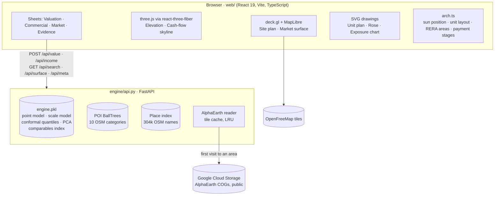

# Architecture

Naksha has two processes:
- A Python **engine** that holds the trained model and every data index in memory and serves JSON.
- A React **console** that draws each valuation as an architectural sheet.



## Request lifecycle: `POST /api/value`

| # | Step | Code | Typical time |
|---|---|---|---|
| 1 | Validate the point is in India; find the nearest covered city | `nearest_city` | < 1 ms |
| 2 | Build the unit frame: area converted to carpet, attributes, facing | `frame_for` | < 1 ms |
| 3 | Comparable features from a haversine BallTree over 88k reference listings | `CompsIndex.features` | 5 ms |
| 4 | OSM access features: nearest distance and counts within 1 and 3 km for 10 categories | `PoiIndex.features` | 5 ms |
| 5 | Satellite embedding: 3 × 3 window from the cached tile, PCA to 16 dims | `aef.embed` → `sat_vec` (LRU) | 5 ms cached · 10–15 s first fetch |
| 6 | Point and scale model, conformal quantiles for the density bin | `predict` | 10 ms |
| 7 | TreeSHAP contributions → grouped rupee waterfall | `pred_contrib` | 20 ms |
| 8 | Source witnesses (4) and facing effects (8): re-predictions | `assemble` + `predict` | 150 ms |
| 9 | Comparables for display, cost approach, flags, routing, lending | inline | 30 ms |

End to end the call takes about 0.5–1 s, and the response reports its own `latency_ms`. Every number in the response can be traced to one of these steps.

`POST /api/income` reuses steps 1–9 for a residential reference unit, to derive the location index. It then runs the income approach in about 50 ms.

## Engine modules

| File | Responsibility |
|---|---|
| `common.py` | Paths, stated assumptions, source years, text normalisation, haversine |
| `build_dataset.py` | Load the four listing sources, parse free text, gazetteer geocoding, write `listings.parquet` |
| `aef.py` | AlphaEarth tile index (India slice), windowed COG reads via rasterio `/vsicurl/`, on-disk `.npz` tile cache |
| `features.py` | POI table and `PoiIndex`, `CompsIndex` with own-locality exclusion, base feature frame |
| `train.py` | Locality trim, three evaluation splits, baselines, ablations, conformal calibration, `Engine` artifact |
| `api.py` | FastAPI app: search, value, income, surface, meta, health |

## Frontend structure

```
web/src/
├── App.tsx              header, sheet tabs, hash deep links; sheets stay mounted once opened
├── api.ts               typed client for every endpoint
├── arch.ts              architecture maths (pure functions, no React)
├── format.ts            ₹ lakh / crore formatting, labels
├── mapStyle.ts          OpenFreeMap positron re-inked as a blueprint
├── sheets/
│   ├── ValuationSheet   title block · elevation + site plan · value + decision · drawing set · evidence
│   ├── IncomeSheet      commercial income approach
│   ├── MarketSheet      H3 price surface (res 4 India, res 8 city)
│   └── EvidenceSheet    benchmark, calibration, ablations, data, pipeline
└── components/
    ├── Elevation        three.js wireframe: storey draw-on, sun path, cast shadow, crane, north point
    ├── SitePlan         deck.gl columns of comparables over MapLibre; click to move the pin
    ├── UnitPlan         SVG plan, RERA area statement, orientation rose
    ├── Construction     payment-plan stage slider, tranche figures, exposure chart
    ├── CashflowSkyline  three.js ten-year NOI columns with PV cores and lease-expiry plane
    ├── ValueDimension   the value drawn as a dimension line with tolerance bands
    ├── Decision         decision band and lending grid
    ├── Evidence         waterfall, witnesses, comparables, land and structure, flags, access
    ├── LocationSearch   local gazetteer search with presets
    └── TitleBlock, ui   form, compass picker, panels, rolling digits
```

**Design system.** All styling follows *Sanction Blueprint* ([../DESIGN.md](../DESIGN.md)):
- Tokens are CSS custom properties in `index.css`.
- 1 px linework, with no shadows or rounded corners.
- One reserved amber ink for the subject property, its value and the decision.
- Archivo Variable condensed caps for labels.

## Performance notes

- **Engine:** the model and indexes load once at startup (about 20 s). Satellite tiles are cached on disk and in memory.
- **3D scenes:** the elevation and cash-flow scenes are lazy-loaded chunks. Geometry is memoised per layout, and per-frame work is limited to opacity ramps and label projection.
- **Labels:** 3D labels are plain DOM nodes moved by a projector on each frame. No portals, so no React reconciliation per frame.
- **Sheets** mount on first visit and then stay mounted (hidden), so a valuation survives a trip to the map.
- **Motion:** `prefers-reduced-motion` collapses every animation.
