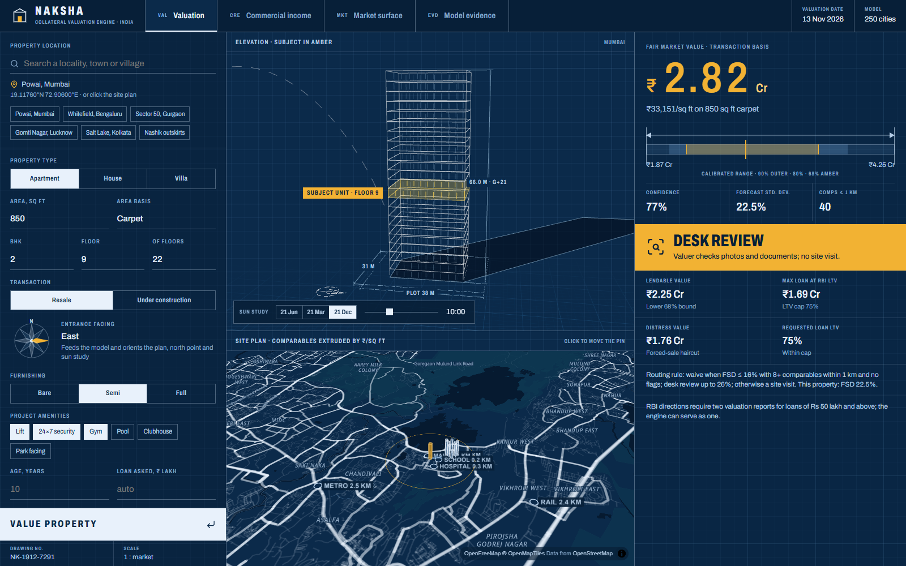
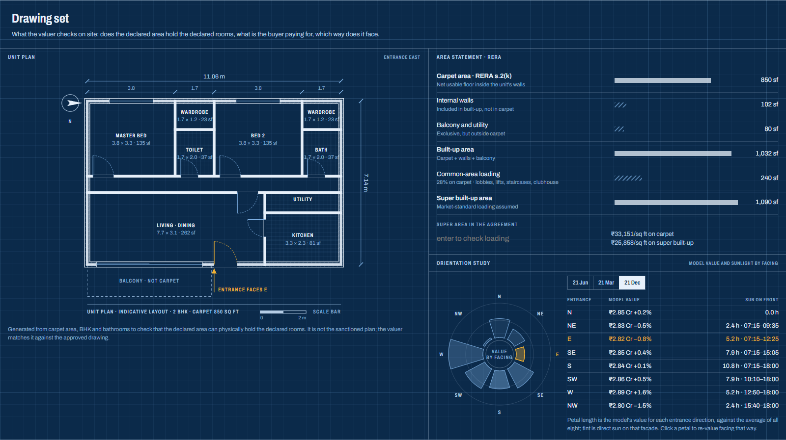
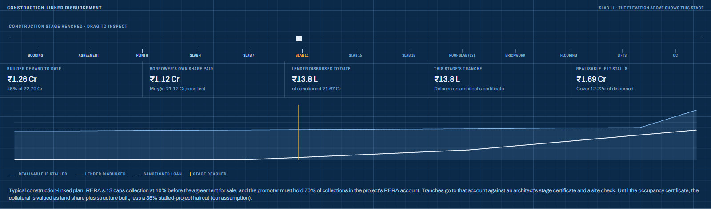
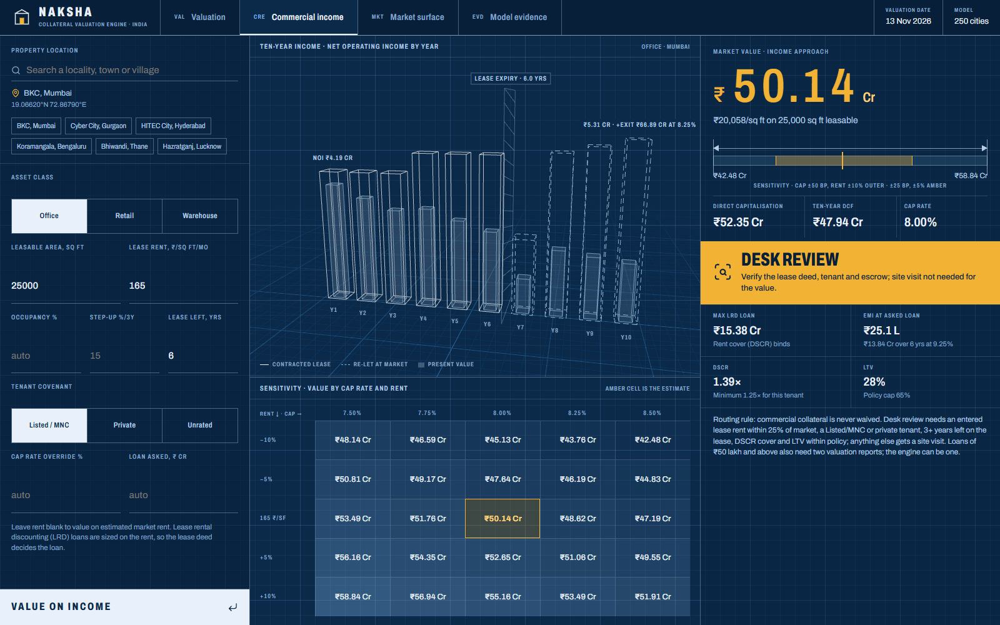
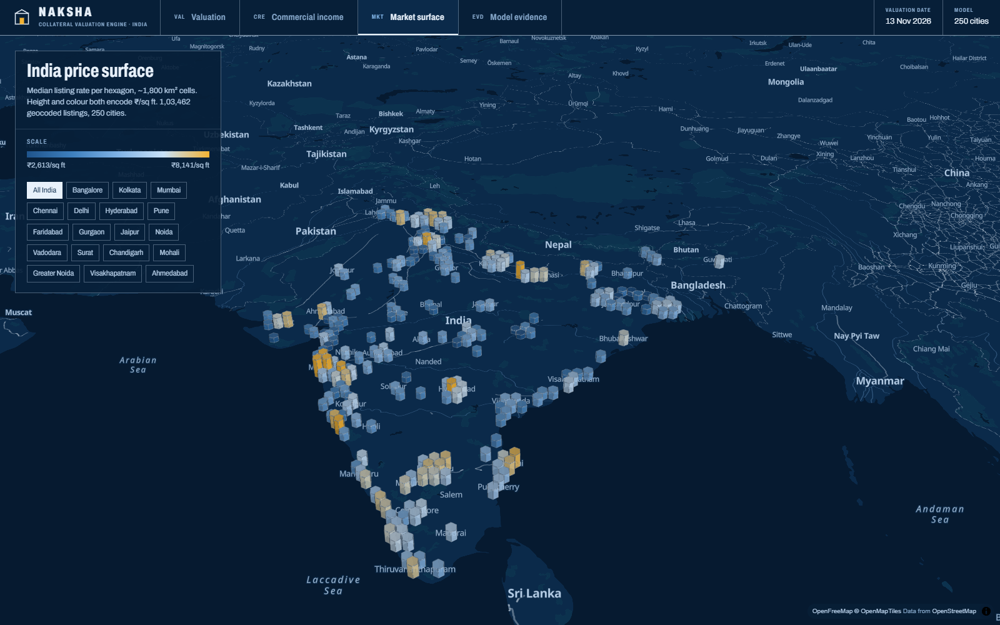
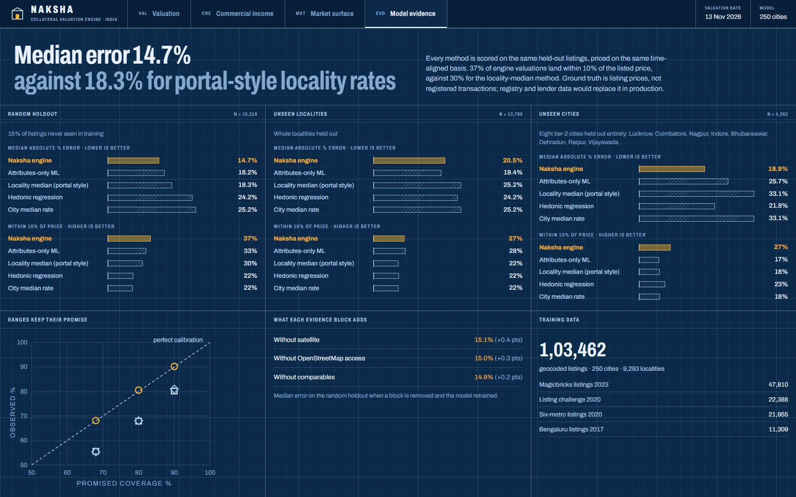

# Guided tour

A route through the console for judges and credit officers. Each section takes about a minute. Start the engine and the web app (see the [README](../README.md#quick-start)), then open http://localhost:5173.

---

## 1. A valuation, read like a drawing

The app opens on a 2 BHK in **Powai, Mumbai** and values it immediately.

| Where | What to read |
|---|---|
| **Right column, top** | The value, drawn as a dimension line. The outer arrows span the 90% range; the amber band is the 68% range; the tick is the estimate. Underneath are confidence, forecast standard deviation (FSD) and comparables within 1 km. |
| **Right column, band** | The decision: **waive**, **desk review** or **physical visit**. The rule, and this property's FSD, are printed under it. |
| **Right column, grid** | Lendable value (lower 68% bound), maximum loan at the RBI LTV cap, distress value, and requested LTV |
| **Centre, top** | A three.js elevation of the building. It draws storey by storey with the subject floor in amber. Use the **Sun study** bar to set the date and time; the sun path and the building's real cast shadow follow. |
| **Centre, bottom** | A 3D site plan. Comparables are extruded by ₹/sq ft, the amber column is the subject, and the ring is 1 km. Labels mark nearby transit, schools and hospitals. **Click the map to move the pin.** |
| **Left column** | The title block: search any locality, town or village, or use a preset. Then set property type, area basis, BHK, floor, transaction, **entrance facing** (click the compass), furnishing and amenities. |

**Try:**
- Pick **Nashik outskirts**. The range widens, `THIN_DATA` appears, and the decision turns to physical visit. The engine refuses to bluff.
- Pick **Gomti Nagar, Lucknow**. Lucknow was entirely held out in the unseen-city test.
- Search a village name, or drop a pin in rural Rajasthan. It still answers, with flags.

## 2. The drawing set

Scroll down. This is the layer a valuer checks on site.

- **Unit plan.** Generated from carpet area, BHK and bathrooms, with walls, door swings, windows, wet rooms and dimension chains. It asks whether this area can hold these rooms. Try 3 BHK in 600 sq ft.
- **RERA area statement.** Carpet → built-up → super built-up. Type a super area from a sale agreement, say 1,300 sq ft for 850 carpet, and watch the loading flag fire.
- **Orientation study.**
  - Petal length is the model's value for each entrance direction, and tint is the sunlight on that facade.
  - Switch between 21 Jun, 21 Mar and 21 Dec.
  - **Click a petal** to re-value the property facing that way.

## 3. Under construction

Set **Transaction → Under construction** and value again. You can also open `#construction` directly.

- **Drag the stage slider** from booking to possession. The 3D elevation draws only the slabs cast so far, and the remaining floors appear as ghosts under a tower crane.
- For each stage the panel shows:
  - the builder's demand to date;
  - the borrower's margin (paid first);
  - the lender's tranche;
  - what the collateral would realise if the project stalled.
- The exposure chart shows where the lender is most exposed.

## 4. Why this number

Further down, **Why ₹X**:

- **Factor attribution.** The rupee walk from an average listing to this property, by evidence block, using exact TreeSHAP contributions.
- **Source reconciliation.** What each listing source would have said, then reconciled.
- **Land and structure.** The cost-approach split.
- **Comparable evidence.** The ten listings the engine leaned on, each with the value it implies.
- **Risk flags, access, stated assumptions.**
- **Print valuation report.** An A4 blueprint-styled report.

## 5. Commercial income (CRE)

- Choose a preset: BKC office, Cyber City, HITEC City, Koramangala retail, Bhiwandi warehouse, or Hazratganj (a tier-2 city with no published rent benchmark).
- The **3D skyline** shows ten years of net operating income (NOI).
  - Solid columns are the contracted lease and dashed columns are re-let years.
  - Filled cores are present value, and the hatched plane marks lease expiry.
- The **sensitivity grid** shows value across cap rate ±50 bp and rent ±10%.
- **Lending** sizes a lease rental discounting loan, bound by DSCR or LTV.
- **Try:**
  - Enter a lease rent 40% above market, or set the lease to 2 years. The routing changes to physical visit.
  - Clear the rent to value the asset at estimated market rent.

## 6. Market surface (MKT)

A 3D H3 hexagon surface built from 103k listings. Height and colour both encode ₹/sq ft. Click a city chip to fly in to neighbourhood resolution.

## 7. Model evidence (EVD)

The proof behind every claim:
- median error on three splits against four baselines, including the one split where a simpler model wins;
- a calibration plot of promised against observed range coverage;
- ablations;
- training data by source;
- the pipeline diagram.

Full write-up: [MODEL.md](MODEL.md).
