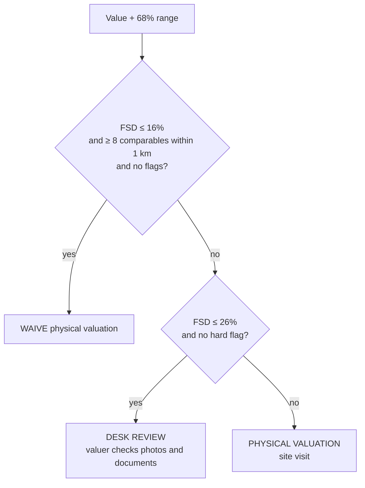

# From value to lending decision

A valuation is only useful to a credit officer if it says what to do next. This document covers every rule the engine applies after the model has produced a value and a range.

**Contents:** [Residential routing](#residential-routing) · [Risk flags](#risk-flags) · [Lendable value and LTV](#lendable-value-and-ltv) · [Construction-linked disbursement](#construction-linked-disbursement) · [Commercial: lease rental discounting](#commercial-lease-rental-discounting) · [Drawing-set checks](#drawing-set-checks)

---

## Residential routing

**FSD** (forecast standard deviation) is half the calibrated 68% range divided by the value. The interface prints the rule and this property's FSD under every decision, so the routing is auditable.

**Why 16% and 26%.** With listing prices as ground truth, irreducible listing noise widens every range. These cut-offs route roughly the densest, most consistent micro-markets to a waive. With registry or lender data as ground truth, typical industry bands of 10% and 20% apply.

## Risk flags

| Flag | Trigger | Hard flag (forces a visit)? |
|---|---|:---:|
| `THIN_DATA` | Comparable-density bin 3: nearest comparables far away | ✔ |
| `OUTSIDE_COVERAGE` | More than 40 km from the nearest covered city | ✔ |
| `ATTRIBUTE_CHECK` | Area per bedroom below 180 or above 1,600 sq ft | ✔ |
| `NO_SATELLITE` | No satellite embedding for the point | |
| `INDUSTRIAL_ADJ` | Industrial land within 250 m | |
| `MODEL_VS_COMPS` | Model value differs from the local comparable level by more than 35% | |

Any flag blocks a waive. A hard flag also blocks desk review.

## Lendable value and LTV

| Quantity | Definition |
|---|---|
| **Lendable value** | Lower bound of the 68% range. The lender advances against a value it is about 84% sure the property is worth at least. |
| **Max loan** | Lendable value × RBI LTV cap for the loan size |
| **Distress value** | Lendable value × (1 − 22%). SARFAESI auctions in India commonly clear 15–30% below market. |
| **Requested LTV** | Loan asked ÷ lendable value, flagged in red above the cap |

**RBI LTV ceilings for individual housing loans:**

| Loan size | LTV cap |
|---|---:|
| Up to ₹30 lakh | 90% |
| ₹30–75 lakh | 80% |
| Above ₹75 lakh | 75% |

RBI directions require **two independent valuation reports for loans of ₹50 lakh and above**. The interface says so and positions the engine as one of the two.

## Construction-linked disbursement

Under-construction homes are lent against in tranches. The *Drawing set* models this with a stage slider, and the 3D elevation draws the building only up to the slab reached.

**Typical construction-linked payment plan** (cumulative % of the agreement value demanded by the builder):

| Stage | Booking | Agreement | Plinth | Slabs (grouped, up to roof) | Brickwork | Flooring and services | Lifts and finish | Possession with OC |
|---|---|---|---|---|---|---|---|---|
| Cumulative | 10% | 20% | 30% | 30 → 60% | 70% | 80% | 90% | 100% |

RERA s.13 caps what a promoter can collect before the agreement for sale at 10%.

**Rules applied:**
1. **Borrower's margin first.** The borrower funds (value − sanctioned loan) before the lender disburses anything.
2. **Lender tranche** = builder demand to date − margin, released against an architect's stage certificate into the project's RERA account. The promoter must keep 70% of collections there.
3. **Exposure check:** compare what has been disbursed with what the collateral would fetch if the project stalled.
   - Before the OC, that is land share plus structure built, less a **35% stalled-project haircut** (our assumption).
   - When cover falls below 1.1×, the panel recommends holding the tranche until the next slab is certified.

## Commercial: lease rental discounting

The *Commercial income* sheet values office, retail and warehouse assets by the income approach and sizes the loan as a lease rental discounting (LRD) loan.

| Step | Rule |
|---|---|
| **Market rent** | City benchmark × (location index)^k. The location index is this point's residential ₹/sq ft against the city median, from the residential engine. k is 0.6 for office, 0.8 for retail and 0.2 for warehouse. |
| **NOI** (net operating income) | Rent × area × 12 × occupancy × (1 − non-recoverable cost ratio) |
| **Direct capitalisation** | NOI ÷ cap rate |
| **Cap rate** | Base cap rate (8.0% office, 8.5% retail, 8.0% warehouse), plus 50 bp for a private tenant or 100 bp for an unrated one, plus 50 bp outside benchmarked metros, plus 25 bp if the lease has under 3 years left |
| **DCF** | 10 years. The lease steps up 15% every 3 years until expiry, then re-lets at market rent (growing 4% a year) after a 6-month void. Exit at cap + 25 bp, discounted at cap + 350 bp. |
| **Market value** | 50 : 50 reconciliation of direct capitalisation and DCF |
| **Max LRD loan** | min(loan serviceable at DSCR, 65% × lower sensitivity bound). Interest 9.25%, tenor capped by the lease (3–12 years). Minimum DSCR 1.25× for a listed or MNC tenant, 1.40× private, 1.60× unrated. |

**Routing.** Commercial collateral is **never waived**. Desk review requires all of:
- an entered lease rent within 25% of market;
- a listed, MNC or established private tenant;
- 3 or more years left on the lease;
- DSCR and LTV within policy.

Everything else goes to a physical valuation.

**Sources.**
- Office rents: Anarock Annual Office Update 2025 (MMR ₹148/sq ft/month) and Business Standard, May 2025 (NCR ₹110, Bengaluru ₹95, Pune ₹80, Hyderabad ₹72, Chennai ₹72).
- Office cap rates: Brookfield India REIT valuation summary, FY26 (7.75–8.0%).
- Our assumptions, labelled in the UI: Kolkata and Ahmedabad rents, retail and warehouse rents and cap rates, and LRD terms.

## Drawing-set checks

| Check | What it catches |
|---|---|
| **Unit plan** | Whether the declared carpet area can hold the declared BHK and bathrooms at livable room sizes |
| **RERA area statement** | Carpet (s.2(k)) → walls → balcony → built-up → loading → super built-up. Entering the agreement's super area computes the real loading; **above 40% is flagged** as a possibly inflated super area. |
| **Orientation study** | Model value for each of the eight facings, plus hours of direct sun on each facade at the solstices and the equinox, computed for the property's latitude and longitude |

## Market reality: what the listings never show

These are applied after the model, with every step shown. Percentages are indicative configuration in `engine/reality.py`.

### 1. Two prices

For each state the engine applies its stamp duty, registration fee and typical circle-to-market ratio. Premium localities get a lower ratio, because circle rates lag the market most where prices rise fastest.

From these it computes:
- the circle-rate value;
- the likely deed value: the agreement value if given, otherwise the circle-rate value;
- the cash gap and the stamp duty lost.

The loan is sized on the **lower of the adjusted 68% bound and the agreement value**.

### 2. Title ladder

| Title | Value adjustment | LTV cap | Acceptable |
|---|---:|---:|:---:|
| Freehold, co-operative society share | 0% | RBI cap | ✔ |
| Leasehold | −5% | RBI cap | ✔ |
| Gram panchayat approval only | −15% | 60% | ✔ |
| Lal Dora / abadi | −20% | 60% | ✔ |
| GPA / power-of-attorney sale | −15% | nil | ✘ (Suraj Lamp, SC 2011) |
| Unauthorised colony | −25% | nil | ✘ until regularised |
| Disputed title | −35% | nil | ✘ |

### 3. Approvals and project

- **OC status (resale):** no OC −12%; CC without OC −6%.
- **RERA status (new):** stalled −30%; not registered −10%; delayed −8%.
- **Developer:** listed +3%; unknown −3%.

### 4. Neighbourhood

**Negative**

| Factor | Adjustment |
|---|---:|
| Railway line | −5% |
| Highway | −3% |
| High-tension line | −8% |
| Landfill | −12% |
| Cremation ground | −6% |
| Informal settlement | −7% |
| Nala | −5% |
| Flooding | −8% |
| Tanker water | −6% |
| No road access | −10% |

**Positive**

| Factor | Adjustment |
|---|---:|
| Metro within a 10-minute walk | +6% |
| View | +8% |
| Gated township | +4% |
| School zone | +3% |
| Corner unit | +2% |

### 5. Integrity signals

| Signal | Trigger | Severity |
|---|---|---|
| `OVER_DECLARED` | Agreement above the adjusted 90% range | high |
| `CASH_COMPONENT` | Agreement within 8% of the circle rate while the market is 25%+ above it | medium |
| `VALUER_ABOVE_RANGE` / `VALUER_BELOW_RANGE` | Valuer figure outside the 80% range | high / low |
| `RAPID_FLIP` | Resold within 3 years at 15+ points a year above market growth | high |
| `RELATED_PARTY` | Buyer and seller related | medium |
| `DUPLICATE_COLLATERAL` | Same point (< 50 m) and area (±5%) already pledged in the book | high |
| `TITLE_NOT_ACCEPTABLE` / `TITLE_WEAK` | Title ladder above | high / medium |
| `NO_OC`, `RERA_*` | Approvals and project above | medium–high |

The integrity score starts at 100 and loses 25 per high-severity flag, 12 per medium and 5 per low.

| Grade | Score |
|---|---|
| Clean | ≥ 85 |
| Review | ≥ 60 |
| Refer | below 60 |

A high-severity fraud signal, or an unacceptable title, overrides the routing: **Refer to fraud control** or **Not acceptable security**.

## Portfolio monitoring

**Revaluation.** Each loan's collateral is revalued in one vectorised pass.

**LTV**
- LTV now is outstanding ÷ current value, compared with the LTV at sanction.
- A breach is LTV above the RBI cap for the loan size.
- An early warning fires on drift above 8 points.
- The stress slider applies a uniform price shock in the browser.

**Valuer scorecard**
- Each origination valuation is compared with the model's back-cast of market value at that date: today's value deflated at 6% a year.
- A valuer is flagged when their median bias exceeds +8% across 10 or more files.

**Double pledges.** Two loans on the same point (< 50 m) with the same area (±5%) are flagged.
